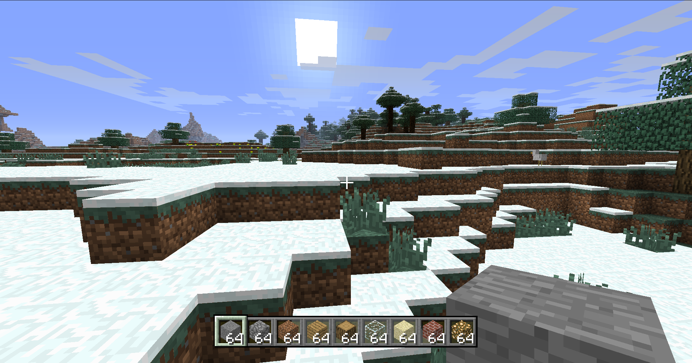
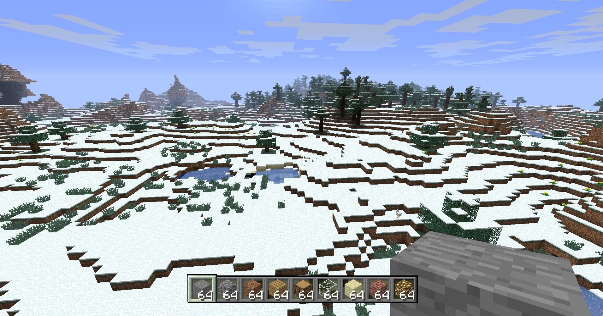
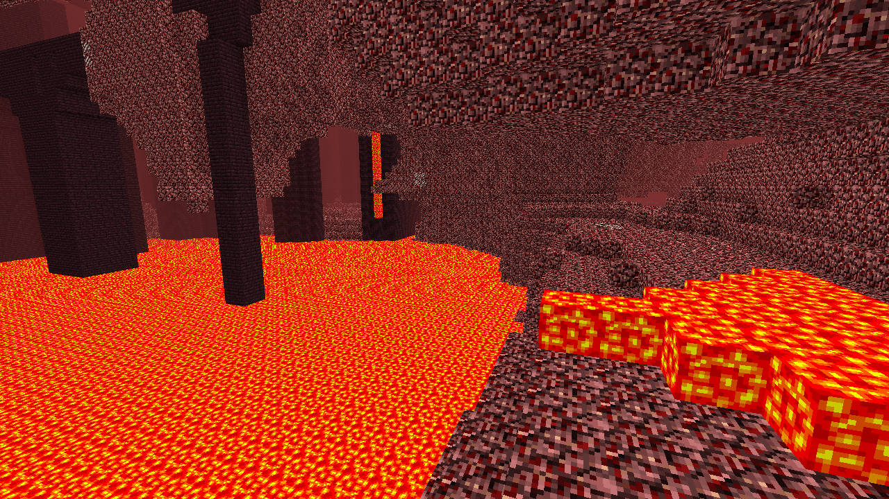
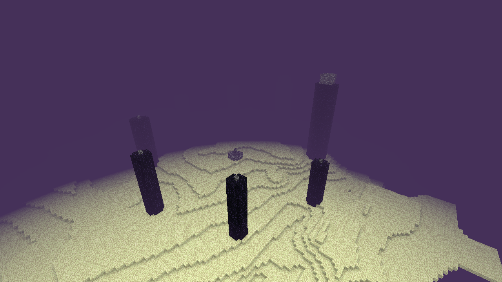

[README.md](https://github.com/user-attachments/files/33610634/README.md)
# Minecraft: Legacy Console Edition — Rust Port

A work-in-progress Rust port of **Minecraft: Legacy Console Edition**, focused on the **Windows 64-bit version** of the game. The project reimplements major parts of the original game engine, world generation, save storage, block and item data, world simulation, and a playable client.

> **Source / attribution:** This project is being ported from the **C++ source code of Minecraft: Legacy Console Edition by 4J Studios**. The Rust code is a port/reimplementation of that codebase, not an official release by Mojang or 4J Studios.

> **Unofficial project:** This project is not affiliated with, endorsed by, or sponsored by Mojang Studios or 4J Studios. Minecraft and related names/assets belong to their respective rights holders. The workspace currently declares `LicenseRef-Proprietary-Study-Only`; do not assume this repository or any original source/assets may be redistributed or used commercially. Check the rights and permissions applicable to the original source before publishing.

## Project status

**Estimated overall progress: ~55%** of the intended Windows 64-bit, single-player port.

This estimate is taken from the project's `PORTING.md` progress log. It represents an estimate of how much of the original C++ behaviour has been implemented and tested—not the percentage of files written, lines of code, or a claim of feature parity. Progress can change as features are implemented and tested.

| Area | Estimated completion | Notes |
|---|---:|---|
| Core math, random numbers, NBT and compression | 98% | Foundational data types and formats |
| Save storage and chunk I/O | 90% | Region/save handling; some save behaviour remains simplified |
| Terrain and biome generation | 95% | Overworld, Nether, End, Flat, caves and decoration |
| Structures | 90% | Villages, strongholds, mineshafts, temples and Nether fortresses; some variants remain |
| Level simulation | 85% | Lighting, ticks, fluids, falling blocks and weather; some behaviours remain incomplete |
| Blocks | 75% | Many block definitions/behaviours exist; several utility/workstation blocks remain |
| Redstone | 80% | Core circuits, dust, torches, repeaters, pistons and TNT; comparator/hopper/dispenser/dropper/rails remain |
| Items | 55% | Core item data and some tools/food/armour/projectiles; many systems remain |
| Inventory and crafting | 60% | Inventory, chest and crafting table; several workstation/container systems remain |
| Survival | 70% | Hunger, XP, damage and death basics; effects and armour details remain |
| Mobs and entities | 27% | A subset of mobs and their AI are implemented |
| Player model, hand and animations | 70% | First-person hand/item rendering; skins and third-person work remain |
| Game renderer | 60% by function | Approximately 85% of the currently targeted single-player visual path, according to `PORTING.md` |
| Chunk rendering, particles, sky and streaming | 85–90% | Worker-based chunk meshing and on-demand chunk streaming |
| GUI screens and options | 50–55% | Core screens/settings exist; several screens and options remain |
| Audio | 60% | Sound lookup/mixing and optional OS audio output |
| Multiplayer, split-screen, DLC, achievements and platform services | 0% | Explicitly outside the current single-player Windows 64-bit scope |

**Current scope:** Windows 64-bit, large-world single-player behaviour. Console-specific platform features and Java Edition features are not the goal of this port. This is a development snapshot; the percentages should be updated as implementation and tests change.

## Screenshots

These images are included in the repository under `screenshots/`.

| Overworld | Overworld — aerial view |
|---|---|
|  |  |

| Nether | The End |
|---|---|
|  |  |

## Workspace layout

This is a Rust Cargo workspace made of separate crates. The lower-level crates are designed to stay independent from the client where possible.

| Crate | Responsibility |
|---|---|
| `mc-core` | Shared math, positions, random number generator and Java-style binary I/O |
| `mc-nbt` | NBT tags and reading/writing |
| `mc-storage` | Save container, region files, file headers and compression |
| `mc-world` | Block/material/biome/direction definitions, item data and crafting recipes |
| `mc-level` | Chunks, level state, lighting, block behaviour and tile entities |
| `mc-worldgen` | Biomes, terrain, caves, decoration, structures, dimensions and world/save generation tools |
| `mc-client` | Interactive client, game logic, chunk meshing, wgpu rendering, GUI, audio and mobs |

## Building and running

You need a recent stable Rust toolchain with Cargo. The client uses `wgpu` and `winit`; the default client feature also enables `cpal` for OS audio output, which may require platform audio development libraries.

```bash
# Build the entire workspace
cargo build --workspace

# Run tests across the workspace
cargo test --workspace

# Run the interactive client
cargo run -p mc-client --bin mcview

# Run the world-generation CLI (example)
cargo run -p mc-worldgen --bin mcgen -- --help
```

The exact command-line arguments supported by each world-generation tool are defined by that tool; check its `--help` output. If building without the optional real-time audio backend is useful for your platform, try:

```bash
cargo run -p mc-client --no-default-features --bin mcview
```

Build/run instructions are provided as a starting point; they have not been verified for every operating system or toolchain by this README.

## World-generation and save tools

`mc-worldgen` provides several command-line utilities for inspecting and testing generated worlds:

| Binary | Purpose |
|---|---|
| `mcgen` | Generate terrain/world previews and related output |
| `mccompare` | Compare generated output against reference data |
| `mcbiomes` | Inspect biome output |
| `mchist` | Generate or inspect distributions/histograms |
| `mccol` | Inspect colour-related output |
| `mcshape` | Inspect terrain/shape output |
| `mcconf` | Inspect configuration/output comparisons |
| `mcpost` | Run or inspect post-processing |
| `mcseq` | Inspect sequences of generated output |
| `mcsave` | Build/write generated chunks and save-world data |

Additional `mc-dim` functionality appears in `mc-worldgen/src/bin/mcdim.rs`; check the workspace manifest and current source before relying on it as a Cargo binary target.

## Rust source code guide

The descriptions below are based on the file names, module declarations, and source comments in this snapshot. They describe each file's main responsibility, not a guarantee that every listed feature is complete.

### `mc-core` — shared engine primitives

| File | What it does |
|---|---|
| `mc-core/src/lib.rs` | Exposes the core modules. |
| `mc-core/src/aabb.rs` | Axis-aligned bounding boxes and collision/intersection helpers. |
| `mc-core/src/data_io.rs` | Java-style binary input/output helpers for primitive values and byte order. |
| `mc-core/src/mth.rs` | Math helpers, including lookup-table trigonometry, square roots and floor operations. |
| `mc-core/src/pos.rs` | Integer block positions and position offsets/comparisons. |
| `mc-core/src/random.rs` | Seeded random number generator intended to reproduce the original game's behaviour. |
| `mc-core/src/vec3.rs` | 3D vector operations such as interpolation, normalization, dot and cross products. |

### `mc-nbt` — NBT data

| File | What it does |
|---|---|
| `mc-nbt/src/lib.rs` | NBT tag types, IDs, limits, errors and public exports. |
| `mc-nbt/src/nbt_io.rs` | Reads and writes NBT compounds and payloads, including depth/size limits. |
| `mc-nbt/tests/nbt.rs` | Tests for NBT encoding/decoding behaviour. |

### `mc-storage` — save files and region storage

| File | What it does |
|---|---|
| `mc-storage/src/lib.rs` | Exposes storage modules and public types. |
| `mc-storage/src/compression.rs` | RLE and zlib compression/decompression helpers. |
| `mc-storage/src/error.rs` | Storage error types and result alias. |
| `mc-storage/src/file_header.rs` | Save-file header, platform identifiers and byte-order helpers. |
| `mc-storage/src/region_cache.rs` | Caches region files and derives region names from chunk coordinates. |
| `mc-storage/src/region_file.rs` | Reads/writes chunk data in region files. |
| `mc-storage/src/save_file.rs` | Save-container file abstraction and file-handle/seek operations. |
| `mc-storage/examples/chunkdump.rs` | Example utility for dumping/inspecting chunk data. |
| `mc-storage/examples/savedump.rs` | Example utility for dumping/inspecting save contents. |
| `mc-storage/examples/scan.rs` | Example utility for scanning storage data. |
| `mc-storage/tests/end_to_end.rs` | End-to-end storage tests. |

### `mc-world` — game data and registries

| File | What it does |
|---|---|
| `mc-world/src/lib.rs` | Exposes world data modules. |
| `mc-world/src/biome.rs` | Biome definitions and related biome properties. |
| `mc-world/src/colours.rs` | Colour tables/helpers used by world and biome rendering. |
| `mc-world/src/direction.rs` | Direction constants and direction-related helpers. |
| `mc-world/src/drops.rs` | Block/item drop definitions and drop-related data. |
| `mc-world/src/facing.rs` | Facing/orientation values used by blocks and structures. |
| `mc-world/src/item.rs` | Item definitions, item kinds and item stacks. |
| `mc-world/src/item_table.rs` | Item ID constants and item registry/table. |
| `mc-world/src/level_type.rs` | World-generation/level type definitions. |
| `mc-world/src/material.rs` | Material types and properties such as colour and push reaction. |
| `mc-world/src/recipe.rs` | Shaped/shapeless recipe matching and crafting-grid logic. |
| `mc-world/src/recipe_table.rs` | Recipe registry/table. |
| `mc-world/src/tile.rs` | Block/tile metadata and block registry access. |
| `mc-world/src/tile_props.rs` | Block properties such as light emission, opacity, solidity and material. |
| `mc-world/src/tile_table.rs` | Block ID constants and tile registry/table. |

### `mc-level` — chunks, simulation and block behaviour

| File | What it does |
|---|---|
| `mc-level/src/lib.rs` | Exposes level, chunk, storage, lighting and behaviour modules. |
| `mc-level/src/behavior.rs` | Block behaviour checks, including placement/survival rules for liquids and plants. |
| `mc-level/src/chunk.rs` | Chunk data, block storage and chunk-level state. |
| `mc-level/src/chunk_io.rs` | Parses serialized chunk data into the Rust chunk representation. |
| `mc-level/src/chunk_save.rs` | Serializes chunk data and tile entities/items for saving. |
| `mc-level/src/level.rs` | World/level container, chunk management and pending tick data. |
| `mc-level/src/light_query.rs` | Light queries and chunk lighting calculations. |
| `mc-level/src/storage.rs` | Nibble arrays and compact storage for light/metadata values. |
| `mc-level/src/tile_entity.rs` | Tile entities and item-stack data, including chest state. |

### `mc-worldgen` — terrain, biomes, structures and dimensions

| File | What it does |
|---|---|
| `mc-worldgen/src/lib.rs` | Exposes world-generation modules. |
| `mc-worldgen/src/biome_source.rs` | Produces biome data from a world seed and level type. |
| `mc-worldgen/src/decorator.rs` | Adds biome vegetation, ores and other surface features. |
| `mc-worldgen/src/end.rs` | The End terrain generator. |
| `mc-worldgen/src/features.rs` | Feature placement helpers for ores, clay, sand, flowers, grass and related features. |
| `mc-worldgen/src/flat.rs` | Flat-world generation and post-processing. |
| `mc-worldgen/src/large_feature.rs` | Large features, including cave/canyon carving helpers. |
| `mc-worldgen/src/layer.rs` | Seeded biome-layer pipeline and layer randomization. |
| `mc-worldgen/src/level_source.rs` | World-generation parameters, chunk data and the Overworld random terrain source. |
| `mc-worldgen/src/monster_room.rs` | Dungeon/monster-room treasure and random loot tables. |
| `mc-worldgen/src/nether.rs` | Nether dimension parameters and terrain generation. |
| `mc-worldgen/src/noise.rs` | Noise functions used to shape terrain. |
| `mc-worldgen/src/populate.rs` | Builds and populates levels/chunks, including lighting-related setup. |
| `mc-worldgen/src/post_process.rs` | Chunk post-processing and structure coordination. |
| `mc-worldgen/src/save_world.rs` | Produces level metadata and writes chunks/level data into a save container. |
| `mc-worldgen/src/structure/mod.rs` | Exposes structure-generation modules. |
| `mc-worldgen/src/structure/ctx.rs` | Shared structure-generation context, coordinate transforms and placement helpers. |
| `mc-worldgen/src/structure/mineshaft.rs` | Mineshaft piece layout and treasure data. |
| `mc-worldgen/src/structure/nether_bridge.rs` | Nether fortress piece definitions and generation layout. |
| `mc-worldgen/src/structure/nether_bridge_gen.rs` | Places individual Nether fortress pieces. |
| `mc-worldgen/src/structure/scattered.rs` | Scattered structure definitions and loot data, such as temples/huts. |
| `mc-worldgen/src/structure/scattered_gen.rs` | Places scattered structures such as desert/jungle pyramids and swamp huts. |
| `mc-worldgen/src/structure/stronghold.rs` | Stronghold layout and piece generation. |
| `mc-worldgen/src/structure/ti.rs` | Structure-related helper/implementation module; inspect source for current details. |
| `mc-worldgen/src/structure/village.rs` | Village piece definitions, layout and village-specific data. |
| `mc-worldgen/src/structure/village_gen.rs` | Places individual village pieces. |
| `mc-worldgen/src/bin/mcbiomes.rs` | CLI tool for inspecting biome data. |
| `mc-worldgen/src/bin/mccol.rs` | CLI tool for colour-related inspection. |
| `mc-worldgen/src/bin/mccompare.rs` | CLI tool for comparing generated output. |
| `mc-worldgen/src/bin/mcconf.rs` | CLI tool for configuration/consistency inspection. |
| `mc-worldgen/src/bin/mcdim.rs` | CLI tool for dimension-related inspection/output. |
| `mc-worldgen/src/bin/mcgen.rs` | Main terrain/world-generation CLI. |
| `mc-worldgen/src/bin/mchist.rs` | CLI tool for histogram/distribution output. |
| `mc-worldgen/src/bin/mcpost.rs` | CLI tool for post-processing generated chunks/worlds. |
| `mc-worldgen/src/bin/mcsave.rs` | CLI tool for writing generated world data to a save. |
| `mc-worldgen/src/bin/mcseq.rs` | CLI tool for sequence-oriented generation inspection. |
| `mc-worldgen/src/bin/mcshape.rs` | CLI tool for inspecting terrain shapes. |

### `mc-client` — playable client and rendering

| File | What it does |
|---|---|
| `mc-client/src/lib.rs` | Exposes client modules. |
| `mc-client/src/bin/mcview.rs` | Client entry point for the title screen, world creation and survival/creative play. |
| `mc-client/src/audio.rs` | Resolves and mixes game sound effects; optional OS audio playback is provided through `cpal`. |
| `mc-client/src/blocks.rs` | Maps block IDs to render styles, face icons and tint rules. |
| `mc-client/src/chest.rs` | Chest model, animated lid and chest rendering coordination. |
| `mc-client/src/entity.rs` | Entity physics body and dropped-item entities. |
| `mc-client/src/entrender.rs` | World-space rendering for entities such as dropped items. |
| `mc-client/src/game.rs` | Interactive game state: player, hotbar, block targeting, breaking and placing. |
| `mc-client/src/gamemobs.rs` | Connects mobs to game simulation, including damage, attacks, feeding and explosions. |
| `mc-client/src/hand.rs` | First-person hand/held-item model and equip animation. |
| `mc-client/src/hud.rs` | Crosshair and hotbar geometry. |
| `mc-client/src/icons.rs` | Terrain texture-atlas layout and icon/UV mapping. |
| `mc-client/src/inventory.rs` | Player inventory, menu slots, click operations, crafting and creative item selection. |
| `mc-client/src/itemmesh.rs` | 3D geometry for held/dropped item sprites and block items. |
| `mc-client/src/mesh.rs` | Converts chunks into render meshes; face culling, ambient occlusion, lighting and biome tinting. |
| `mc-client/src/meshpool.rs` | Worker-thread pool for chunk mesh generation. |
| `mc-client/src/mob.rs` | Mob types, species and AI/control components. |
| `mc-client/src/mobrender.rs` | Rendering for mobs and arrows. |
| `mc-client/src/mobs.rs` | Mob/arrow simulation, spawning, breeding, pushing and targeting. |
| `mc-client/src/model.rs` | CPU-side models and geometry for humanoids, quadrupeds, chickens and creepers. |
| `mc-client/src/particles.rs` | Block-hit/block-break particles and particle physics/render geometry. |
| `mc-client/src/path.rs` | A* pathfinding data structures and path search. |
| `mc-client/src/pearl.rs` | Thrown ender pearl movement, collision, particles and teleport behaviour. |
| `mc-client/src/physics.rs` | Player movement, collision, swimming, flying, jumping and block raycasts. |
| `mc-client/src/piston.rs` | Piston extension/retraction, moving blocks and piston-head behaviour. |
| `mc-client/src/redstone.rs` | Redstone dust, levers, buttons, plates, torches, repeaters and connected mechanisms. |
| `mc-client/src/render.rs` | Main `wgpu` renderer, opaque/blended passes, fog and terrain atlas rendering. |
| `mc-client/src/save.rs` | Client settings and local world/chunk persistence. |
| `mc-client/src/screens.rs` | Title, world creation, pause, options, inventory, crafting and creative-picker screens. |
| `mc-client/src/shapes.rs` | Multi-box block shapes such as stairs, doors, trapdoors, fences and switches. |
| `mc-client/src/sky.rs` | Sky colours, sun/moon/stars, clouds and fog parameters/geometry. |
| `mc-client/src/skyrender.rs` | GPU rendering of sky and clouds. |
| `mc-client/src/soundtypes.rs` | Per-block step/dig/place sound mappings. |
| `mc-client/src/stream.rs` | On-demand chunk generation/loading, decoration, lighting, saving and eviction. |
| `mc-client/src/survival.rs` | Hunger, exhaustion, regeneration, starvation, drowning and experience basics. |
| `mc-client/src/tnt.rs` | Primed TNT fuse, movement, flashing and rendering data. |
| `mc-client/src/ui.rs` | GUI geometry, text/texture quads and batched UI rendering. |
| `mc-client/src/weather.rs` | Rain/thunder state, lightning and rain/snow rendering geometry. |
| `mc-client/src/world.rs` | Creates or loads worlds and provides dimension/world access to the client. |

## Implementation notes

- The renderer uses **`wgpu`/`winit`**, rather than wrapping the original fixed-function OpenGL renderer.
- The project includes tests in several lower-level crates so core formats and world-generation behaviour can be validated independently.
- The current port focuses on reproducing the targeted Windows 64-bit single-player behaviour. Multiplayer, split-screen and console platform services are not currently implemented.
- A feature being present in a source file does not necessarily mean it is complete or fully parity-tested; use `PORTING.md` as the detailed implementation log.

## Contributing / reporting issues

Issues and pull requests should include:
- The operating system and Rust toolchain version.
- The command used to build/run the project.
- Relevant logs or crash output.
- A minimal reproduction case, seed, or save file when a world-generation or save bug is involved.

Before contributing, please review the project's source-rights and redistribution constraints. This is a port of proprietary game source, so repository visibility does not automatically grant permission to redistribute the original code or game assets.

## Credits

- **4J Studios** — original Minecraft: Legacy Console Edition C++ source code that this port is based on.
- **Mojang Studios / Microsoft** — Minecraft and its related intellectual property.
- Rust ecosystem maintainers — including the crates used by this project.

This is an unofficial, work-in-progress port and is not an official Minecraft product.
